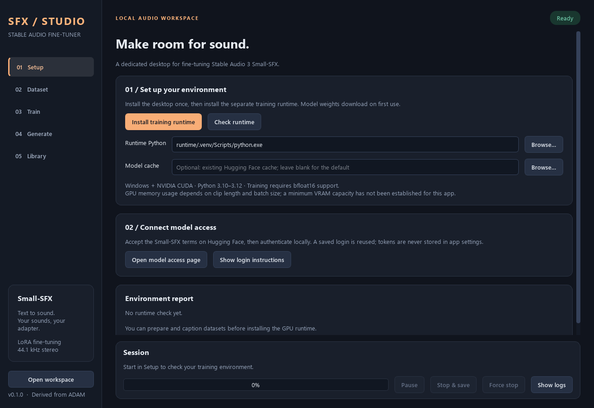

# Stable Audio Fine-Tuner

A Python desktop workspace for **Stable Audio 3 Small-SFX LoRA fine-tuning**, derived
from ADAM. Prepare captioned clips, train an adapter, and listen to generated sound
effects in one app.



## Features

- PySide6 desktop with Setup, Dataset, Train, Generate, and Library pages.
- Audio/video import through FFmpeg, non-destructive clipping, source deduplication,
  and source-grouped train/holdout splits.
- Per-clip `.txt` captions, inherited source captions, and waveform playback.
- LoRA rank, epochs, batch size, learning rate, seed, and checkpoint interval.
- Live batch loss, progress, logs, cooperative pause, and stop with checkpoint saving.
- Base-model or LoRA generation, negative prompts, guidance, strength, and WAV export.
- Existing ADAM Small-SFX dataset and adapter folder support.
- UI and machine-learning dependencies run in separate Python environments.

## Requirements

This first release targets **Windows 10/11 with an NVIDIA CUDA GPU**.
Training uses bfloat16 and requires a GPU that supports it (Ampere or newer).
Generation also requires CUDA in this app. macOS, CPU training, and Linux GPU
installation have not been validated.

Install Python **3.10, 3.11, or 3.12**, Git, and FFmpeg. Their executables must be
available on PATH. A recent NVIDIA driver compatible with CUDA 12.6 is required for
the pinned PyTorch wheels. No separate CUDA toolkit is needed by the setup script.

GPU memory requirements depend strongly on clip duration, batch size, and other GPU
workloads. A general minimum has not been established. Start with a short dataset
and batch size 1. See [validation notes](docs/VALIDATION.md) for measured checks and limitations.

## Install and launch

1. Download/clone this repository into a writable folder.
2. Double-click **Setup.bat** to install the desktop environment.
3. Double-click **Launch.bat**.
4. In Setup, choose **Install training runtime**, then **Check runtime**.
5. Open the [Small-SFX model page](https://huggingface.co/stabilityai/stable-audio-3-small-sfx),
   review/accept the model terms, and run **Login to Hugging Face.bat**.

Installation downloads the ML dependencies. The first training/generation run also
downloads model and text encoder weights, which can take several minutes. The app
uses the standard Hugging Face cache/login and respects `HF_HOME` and `HF_TOKEN`.
Tokens are never written to app settings, job requests, or documentation.
Accept terms directly on Hugging Face; this app cannot accept them for you.
The optional **Model cache** field lets you reuse a Hugging Face cache from another
installation. Choose the cache root containing `hub/`; this does not copy or move weights.

To run directly in an existing desktop Python environment:

```powershell
python -m pip install -e ".[dev]"
python main.py
```

To use an existing compatible Stable Audio runtime, select its Python executable
on the Setup page, or pass it explicitly:

```powershell
python main.py --runtime-python "C:\path\to\runtime\Scripts\python.exe"
```

This does not modify that environment. Runtime compatibility is checked by importing
the model and training wrapper. Use the pinned upstream revision for reproducible behavior.
The app never needs an ADAM installation; an existing environment is an optional shortcut.

## Train your first adapter

1. In **Dataset**, import recordings or a folder. Add a matching `.txt` beside each
   source recording to inherit captions, or enter an optional shared description.
2. Choose clip length and overlap, then **Prepare dataset**. Prepared audio is
   44.1 kHz stereo 16-bit PCM WAV. Source recordings are not modified.
3. Review descriptions in the caption table. A whole-recording caption may not
   describe every crop accurately. All training clips need nonempty captions.
4. In **Train**, select the dataset and name the adapter. A conservative starting
   configuration is batch 1, rank 8, and learning rate 0.0001; tune epochs for your data.
5. Start fine-tuning. Check loss and logs, then use **Generate** to audition the adapter.

Only LoRA parameters train. The generator, text encoder, and codec remain frozen.
The app consistently uses **small-sfx-base**, including for inference. This is not the
post-trained few-step `small-sfx` inference checkpoint; the default is 50 sampling steps.

Validation clips are grouped by original recording and held out. This integration
reports **training loss only**; it does not calculate validation loss or automatically
generate training previews. Small losses do not establish perceptual quality.

**Pause** takes effect at the next batch, dataset, or sampling boundary; it retains
GPU memory. **Stop & save** lets training save its latest adapter at a safe boundary.
Downloads and model loading may take time to reach that boundary. **Force stop**
terminates the process tree and may lose work since the latest saved checkpoint.

**Continue from** loads adapter weights with a **fresh optimizer** into a new output
folder. It does not restore optimizer or scheduler state. Rank follows the adapter.
Periodic `epoch_XXXXXX.safetensors` files are retained; the app selects a model folder's
latest `adapter.safetensors`.

## Files and compatibility

```text
workspace/
  datasets/<name>/dataset.json, clips/*.wav, clips/*.txt
  models/<name>/audio_model.json, adapter.safetensors, epoch_*.safetensors
  generations/<name>/generation.json, clip_*.wav
  jobs/<id>/request.json, output.log, result.json
runtime/                 # Separate ML venv and pinned upstream checkout
.venv/                   # Desktop venv
local-settings.json      # Local UI settings and externally opened folders
```

Open ADAM folders using **Open prepared dataset** or **Open adapter folder**. They
are used in place, so caption edits update the opened dataset's `.txt` files. Copy a
dataset folder yourself first if you want an independent version. External adapter
weights are read without modification; continuation always creates a new folder.

`--workspace-root "D:\another\folder"` relocates the workspace and local settings.
The installer always targets this repository's `runtime/`; select that runtime on
Setup when using a separate workspace root.

All generated data, environments, logs, caches, and settings are excluded by
`.gitignore`. Publish the source repository without these local artifacts.

## Troubleshooting

- **Runtime imports fail:** rerun runtime installation and inspect Session logs.
- **No CUDA / bfloat16:** verify the NVIDIA driver and GPU support, then check runtime again.
- **Model access denied:** accept the model terms while signed in, log in with that
  runtime's `hf auth login`, and retry. A saved login does not establish gated access.
- **Out of memory:** reduce batch size or clip length and close other GPU programs.
- **FFmpeg missing:** add its `bin` folder to PATH, then restart the app.
- **No trainable dataset:** ensure the dataset completed and all training clips have captions.
- **A run appears stuck:** show logs; model loading can take several minutes. Use
  Stop & save first. Use Force stop only if you accept losing unsaved progress.

## Development and checks

```powershell
python -m pip install -e ".[dev]"
$env:QT_QPA_PLATFORM = "offscreen"
python -m pytest -q
python scripts/capture_ui.py
```

An explicit GPU smoke check uses synthetic diagnostic audio and writes under
`workspace/diagnostics/`. It loads weights and may download them if not cached:

```powershell
python scripts/smoke_gpu.py --runtime-python "runtime\.venv\Scripts\python.exe"
```

See [architecture](docs/ARCHITECTURE.md), [validation](docs/VALIDATION.md), and
[third-party notices](THIRD_PARTY_NOTICES.md). App code is MIT licensed. Model weights
and their components have separate terms; review the linked model cards before use.

To create a source-only archive for sharing (environments, weights, and local data
are excluded):

```powershell
python scripts/package_source.py
```

